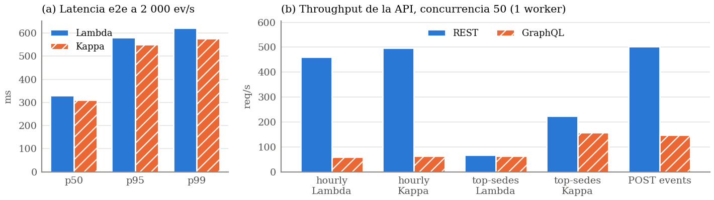

# bi-lambda-kappa-bench

Benchmark de dos arquitecturas de ingesta (**Lambda** y **Kappa**) y dos arquitecturas de API
(**REST** y **GraphQL**) sobre marcaciones de asistencia **anonimizadas** del Ministerio Público,
Distrito Fiscal de Puno (2019 a junio de 2021: 218 841 eventos, 460 personas, 16 sedes).
En 2020-2021 hay muchos menos registros: además del trabajo remoto por la pandemia, para evitar el
contagio se usaron otros medios de registro de asistencia que no están en esta fuente.

Business Intelligence, maestría (FINESI). Actividad N° 1: Arquitecturas.

> Informe (2 páginas, IEEEtran): [`report/informe.pdf`](report/informe.pdf). Resultados crudos: [`bench/results/`](bench/results/).

## Stack

PostgreSQL 16 · Redpanda (API de Kafka) · Python 3.11 · Docker Desktop (Windows 11).

## Arquitectura (Kappa)

```
data/marcaciones.csv ──producer──▶ Redpanda "marcaciones" (3 particiones, retención infinita)
                                          │
                                processor (kappa_vN) ──▶ kappa_view_vN ◀── kappa_serving (vista)
                                          │
                        replay desde offset 0 ──▶ kappa_view_v(N+1) ──▶ promoción
```

- **Exactly-once (efecto):** cada lote escribe el agregado, los `event_id` vistos y los offsets
  en una sola transacción de PostgreSQL. Al arrancar se leen los offsets de la BD y se hace `seek`;
  `enable.auto.commit = false`.
- **Idempotencia:** `event_id` es determinista (uuid5); `kappa_seen_vN` evita contar dos veces un
  evento reenviado.
- **Reproceso:** `replay` crea una versión nueva con su propio consumidor, lee el topic desde el
  offset 0 y, al alcanzar el final, cambia `kappa_serving` con `CREATE OR REPLACE VIEW`.

## Arquitectura (Lambda)

```
Redpanda ──master sink──▶ master_events (solo inserción, event_id único, partición + offset)
    │                          │
    │                     batch layer: recálculo completo hasta el cutoff ──▶ batch_view_a / _b
    │                                                                              │ (batch_active)
    └──speed layer (offsets >= cutoff, por bloques) ──▶ speed_view                 │
                                                          └──── lambda_serving = batch + speed
```

- **Batch:** el cutoff es el offset confirmado por el master sink, alineado al bloque de la speed
  layer (`LAMBDA_BLOCK_SIZE`). Recalcula en la tabla inactiva y, en una sola transacción, mueve el
  cutoff, purga la speed layer por debajo de él y cambia `batch_active` (A/B).
- **Speed:** cuenta un evento solo si su offset es >= cutoff, el batch no lo contó ya y la propia
  speed layer no lo vio antes (`speed_seen`), así que los reenvíos no inflan el resultado.
- **Coordinación:** cada lote de la speed layer toma un bloqueo compartido sobre `lambda_cutoff`;
  el batch no puede purgar un lote a medio confirmar (hay un test que fuerza esa carrera).

## Cómo levantarlo

```bash
cp .env.example .env              # y cambiar ANON_SALT y POSTGRES_PASSWORD
pip install -e ".[dev]"
python tasks.py up                # Postgres + Redpanda + topic con 3 particiones
python tasks.py seed              # dimensión de sedes
python tasks.py anon              # genera data/marcaciones.csv (requiere las fuentes locales)
```

## Kappa

```bash
python tasks.py produce                   # envía las 218 841 marcaciones al topic
python tasks.py kappa --until-caught-up   # procesa el backlog (sin la opción: modo continuo)
python tasks.py verify                    # las vistas deben cuadrar exactamente con el CSV
python tasks.py replay                    # replay completo a v(N+1) y promoción
```

## Lambda

```bash
python tasks.py lambda --until-caught-up  # master sink + speed layer en paralelo
python tasks.py batch                     # recálculo batch A/B (--every 60 para repetirlo)
python tasks.py verify                    # Kappa y Lambda deben cuadrar con master_events y el CSV
```

## APIs

```bash
python tasks.py api        # construye la imagen y levanta api-rest y api-graphql (1 worker cada una)
```

- REST (FastAPI): http://localhost:8000/docs
- GraphQL (Strawberry): http://localhost:8001/graphql (GraphiQL)

Las dos comparten `src/lkbench/api/repository.py` (mismas consultas SQL parametrizadas); solo
cambia la capa de API. `arch` solo acepta `lambda` (vista `lambda_serving`) o `kappa`
(`kappa_serving`).

| Operación | REST | GraphQL |
|---|---|---|
| Serie por hora | `GET /api/v1/sedes/{id}/hourly?from=&to=&arch=` | `{ hourly(sedeId, from, to, arch) { bucket marcaciones tardanzas } }` |
| Ranking | `GET /api/v1/top-sedes?limit=&arch=` | `{ topSedes(limit, arch) { sedeId nombre marcaciones tardanzas } }` |
| Resumen | `GET /api/v1/sedes/{id}/summary?arch=` | `{ summary(sedeId, arch) { marcaciones tardanzas tasaTardanza horas desde hasta } }` |
| Ingesta | `POST /api/v1/events` → 202 | `mutation { ingestEvents(events: [...]) }` |
| Salud | `GET /health` | `GET /health` |

Ejemplos:

```bash
curl "http://localhost:8000/api/v1/top-sedes?limit=3&arch=kappa"
curl -X POST http://localhost:8001/graphql -H "Content-Type: application/json"      -d '{"query":"{ topSedes(limit: 3, arch: KAPPA) { nombre marcaciones tardanzas } }"}'
```

Fechas sin zona horaria en `from`/`to` se interpretan en hora de Perú (-05:00). La ingesta
responde cuando Redpanda confirmó la escritura (aún no procesada por Kappa/Lambda); si
`produced_at` es 0, la API pone la hora actual.

Los procesadores también pueden correr como contenedores en modo continuo:
`docker compose --profile stream up -d` (kappa, lambda-master, lambda-speed, lambda-batch).

## Benchmark

```bash
python tasks.py bench          # ingesta + API + figuras (≈ 1 h); o por partes: bench ingest | api | plot
python tasks.py report         # regenera tablas/cifras y compila report/informe.pdf (requiere tectonic)
```

- **Ingesta** (`bench/run_ingest.py`): cada corrida usa un esquema de PostgreSQL desechable y los
  procesadores en contenedores. Throughput con el backlog real completo; latencia de extremo a
  extremo a carga constante (2 000 ev/s, 30 s, reemitiendo marcaciones reales con `produced_at`
  actual); reproceso (replay Kappa a v2 frente a recálculo batch); CPU/RAM con `docker stats`;
  líneas de código; y consistencia exacta de cada vista.
- **API** (`bench/run_api.py`): [oha](https://github.com/hatoo/oha) en un contenedor de la misma red,
  un worker por API; escenarios `hourly`, `top-sedes` y `POST events` sobre ambas vistas;
  concurrencia 10 y 50, 10 s de calentamiento y 30 s de medición.
- 3 repeticiones por escenario; se reporta la mediana. Las cifras del informe salen solo de
  `bench/results/` (`bench/plot.py` genera `report/numbers.tex` y las tablas).

| Archivo | Contenido |
|---|---|
| `bench/results/ingest_raw.json` | todas las corridas de ingesta, entorno y complejidad |
| `bench/results/ingest_summary.csv` | medianas por arquitectura |
| `bench/results/api_raw.json` | todas las corridas de API (salida de oha) |
| `bench/results/api_summary.csv` | medianas por API, escenario, vista y concurrencia |
| `bench/results/fig_bench.png` | figura del informe |



### Resultados (mediana de 3 repeticiones; detalle en `bench/results/`)

| Ingesta | Lambda | Kappa |
|---|---:|---:|
| Throughput con el backlog completo (ev/s) | 22 963 | 32 793 |
| Latencia e2e p50 / p99 a 2 000 ev/s (ms) | 331 / 622 | 310 / 577 |
| Reproceso completo del histórico (s) | 0,61 | 6,49 |
| CPU media de los procesadores (%) | 120 | 66 |
| Líneas de código propias / servicios | 173 / 3 | 119 / 1 |
| Cuadra exactamente con la referencia | sí | sí |

- **API (concurrencia 50, 1 worker):** REST atiende 7,8 veces más req/s que GraphQL en `hourly`,
  1,4 veces en `top-sedes` y 3,4 veces en `POST events`; 0 % de errores. GraphQL satura su CPU en
  serializar campo a campo. `top-sedes` es 3,3 veces más rápido sobre Kappa que sobre Lambda
  (`lambda_serving` une batch y speed en cada consulta).
- **Conclusión:** para este caso conviene **Kappa** (más throughput, latencia equivalente, menos
  código y una sola ruta de cálculo); Lambda solo si el reproceso frecuente del histórico es
  crítico. En la API conviene **REST** con consultas fijas; GraphQL, si hay clientes con
  necesidades de datos muy distintas.

## Tests

```bash
pytest -q
```

Los tests de integración (`-m integration`) usan un topic y un esquema de prueba propios y se
saltan si Postgres o Redpanda no están levantados (como en CI).

## Datos personales

Las fuentes (padrón y marcaciones) **nunca** se versionan. `staff_id` es un HMAC-SHA256 truncado
del DNI con una sal que solo existe en `.env`. Al repositorio no llegan nombres, DNI, celulares
ni sueldos.
